# Manual de usuario · PMS Hotel (demo)

**Simulador de registro hotelero** · Property Management System desarrollado por **Marine Data Lab**

Este manual explica cómo usar el sistema día a día, módulo por módulo y según el rol de cada usuario. Las capturas corresponden a los datos de demostración que trae la aplicación.

---

## Contenido

1. [Introducción](#1-introducción)
2. [Primeros pasos](#2-primeros-pasos)
3. [La pantalla de trabajo](#3-la-pantalla-de-trabajo)
4. [Conceptos clave](#4-conceptos-clave)
5. [Inicio (panel de control)](#5-inicio-panel-de-control)
6. [Reservaciones](#6-reservaciones)
7. [Recepción](#7-recepción)
8. [Caja](#8-caja)
9. [Habitaciones](#9-habitaciones)
10. [Perfiles](#10-perfiles)
11. [Fin de día](#11-fin-de-día)
12. [Configuración](#12-configuración)
13. [Contacto](#13-contacto)
14. [Flujos de trabajo paso a paso](#14-flujos-de-trabajo-paso-a-paso)
15. [Guía rápida por rol](#15-guía-rápida-por-rol)
16. [Mensajes del sistema y solución de problemas](#16-mensajes-del-sistema-y-solución-de-problemas)
17. [Preguntas frecuentes](#17-preguntas-frecuentes)
18. [Glosario](#18-glosario)
19. [Anexo: datos de demostración](#19-anexo-datos-de-demostración)

---

## 1. Introducción

El PMS es el sistema central de gestión de un hotel. Con él se controla todo el ciclo de la estadía de un huésped:

```
Reserva  →  Llegada (check-in)  →  Estadía (cargos y pagos)  →  Salida (check-out)  →  Cierre del día (auditoría)
```

Funciones principales:

| Área | Qué permite hacer |
|---|---|
| **Reservaciones** | Crear, buscar, modificar, cancelar y reactivar reservas; consultar disponibilidad y el *rack* de habitaciones |
| **Recepción** | Registrar llegadas y salidas, *walk-ins*, cambios de habitación y ver el plano del hotel |
| **Caja** | Llevar la cuenta (folio) de cada huésped: cargos, pagos, correcciones, facturas y cuentas por cobrar |
| **Habitaciones** | Controlar la limpieza (ama de llaves) y bloquear habitaciones fuera de orden o de servicio |
| **Perfiles** | Fichas de huéspedes y de empresas o agencias |
| **Fin de día** | Auditoría nocturna (cierre del día) y reportes |
| **Configuración** | Datos del hotel, tarifas, usuarios, bitácora y respaldo de datos |

### Sobre esta versión de demostración

- Es una aplicación web que funciona completamente en el navegador; no necesita instalación.
- **Los datos se guardan sólo en su navegador** (almacenamiento local). Cada computador y cada navegador tiene su propia copia. Si borra los datos de navegación, la información se pierde.
- Para respaldar o trasladar la información use **Configuración → Datos del hotel → Exportar JSON** (ver [12.1](#121-datos-del-hotel)).
- El botón **Continuar con Google** de la pantalla de inicio todavía no está activo: llegará con la versión conectada a servicios de Google.

---

## 2. Primeros pasos

### 2.1 Requisitos

- Un navegador moderno y actualizado: Chrome, Edge, Firefox o Safari.
- Pantalla de 1280 px de ancho o más para trabajar con comodidad. En tablets y teléfonos el menú se abre con el botón **☰**.
- Si va a imprimir documentos (confirmaciones, tarjetas de registro, facturas, reportes), una impresora o la opción *Guardar como PDF* del navegador.

### 2.2 Abrir el sistema

- **Publicado en GitHub Pages:** abra la dirección del sitio, por ejemplo `https://<usuario>.github.io/Simulador_registro_hotelero/`.
- **En un computador local:** dentro de la carpeta del proyecto ejecute

  ```bash
  python3 -m http.server 8000
  ```

  y abra `http://localhost:8000` en el navegador.

### 2.3 Iniciar sesión

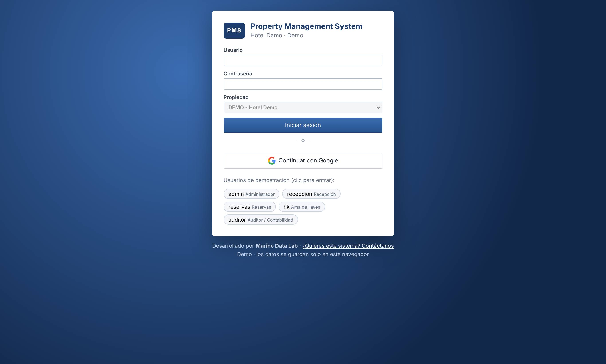

1. Escriba su **Usuario** y **Contraseña** y pulse **Iniciar sesión**.
2. O bien, haga clic en uno de los **usuarios de demostración** que aparecen bajo el formulario para entrar directamente.

Usuarios incluidos en la demo:

| Usuario | Contraseña | Rol | Para qué sirve |
|---|---|---|---|
| `admin` | `admin` | Administrador | Acceso total |
| `recepcion` | `recepcion` | Recepción | Llegadas, salidas, caja y reservas |
| `reservas` | `reservas` | Reservas | Reservas, perfiles y tarifas |
| `hk` | `hk` | Ama de llaves | Estado y limpieza de habitaciones |
| `auditor` | `auditor` | Auditor / Contabilidad | Auditoría nocturna, caja, cuentas por cobrar y reportes |

> La sesión dura mientras la pestaña del navegador esté abierta. Al cerrarla, tendrá que volver a iniciar sesión.

### 2.4 Cerrar sesión

Pulse **Salir** en la esquina superior derecha. Cierre siempre la sesión si comparte el computador con otros usuarios: todas las acciones quedan registradas en la bitácora con su nombre de usuario.

---

## 3. La pantalla de trabajo

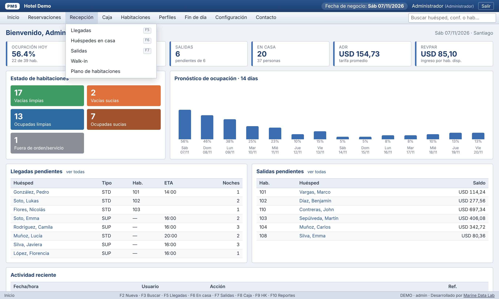

La pantalla tiene cuatro zonas:

1. **Barra de título** (azul oscuro): nombre del hotel, **fecha de negocio**, usuario conectado con su rol y botón **Salir**.
2. **Barra de menú**: *Inicio*, los menús de cada módulo (pase el ratón o haga clic para desplegarlos), *Contacto* y la **búsqueda rápida** a la derecha. Sólo verá los menús y opciones permitidos para su rol.
3. **Área de trabajo**: la pantalla del módulo abierto.
4. **Barra de estado** (abajo): nombre de la pantalla actual, recordatorio de atajos de teclado, código del hotel y usuario.

### 3.1 Búsqueda rápida

Escriba en el campo **Buscar huésped, conf. o hab...** un apellido, nombre, número de confirmación, número de habitación o email y pulse **Enter**. Se abrirá *Buscar reservas* con los resultados de **todas** las reservas, incluidas cerradas y canceladas.

### 3.2 Atajos de teclado

| Tecla | Abre |
|---|---|
| `F2` | Nueva reserva |
| `F3` | Buscar reservas |
| `F5` | Llegadas |
| `F6` | Huéspedes en casa |
| `F7` | Salidas |
| `F8` | Caja (Facturación / Folios) |
| `F9` | Ama de llaves |
| `F10` | Reportes |
| `Esc` | Cierra la ventana emergente abierta |

- Los atajos no funcionan mientras haya una ventana emergente abierta; ciérrela primero con `Esc`.
- Si su rol no tiene permiso para la función, aparece el aviso *Sin permiso para esta función*.
- En algunos portátiles hay que mantener pulsada la tecla `Fn` para usar las teclas F.

### 3.3 Avisos y ventanas

- Los **avisos** aparecen unos segundos en la esquina de la pantalla: verde para acciones correctas, rojo para errores, azul para información.
- Las **ventanas emergentes** (check-in, pagos, perfiles, etc.) se cierran con **Cancelar**, con la **×**, haciendo clic fuera de ellas o con `Esc`.
- Las acciones irreversibles (cancelar una reserva, cerrar el día, reiniciar datos) piden siempre confirmación.

### 3.4 Imprimir

Los botones **Confirmación**, **Tarjeta**, **Imprimir factura**, **Hoja de trabajo** e **Imprimir** (reportes) abren el diálogo de impresión del navegador con un documento con el encabezado del hotel. Para obtener un PDF, elija *Guardar como PDF* como impresora.

---

## 4. Conceptos clave

### 4.1 Fecha de negocio

La **fecha de negocio** es el "día hotelero" en curso y se muestra siempre en la barra de título. **No cambia sola a medianoche:** sólo avanza al día siguiente cuando se ejecuta la **auditoría nocturna** ([11.1](#111-auditoría-nocturna)). Todo el sistema trabaja con ella:

- Las llegadas y salidas "de hoy" son las de la fecha de negocio.
- El check-in sólo se puede hacer en la fecha de llegada de la reserva.
- Los cargos y pagos se registran con la fecha de negocio.
- No se pueden crear reservas con llegada anterior a la fecha de negocio.

Al generar los datos de demostración, la fecha de negocio es la fecha real del día.

### 4.2 Estados de una reserva

| Estado | Significado | Cómo se llega |
|---|---|---|
| **Reservada** | Pendiente de llegada | Al crear la reserva o al reactivarla |
| **En casa** | El huésped está alojado | Check-in |
| **Salida** | Estadía terminada | Check-out |
| **Cancelada** | Anulada antes de llegar | Botón *Cancelar* |
| **No show** | El huésped no llegó | La auditoría nocturna la marca automáticamente |

```
              ┌──────────── Cancelar ───────────┐
              ▼                                  │
         Cancelada ── Reactivar ──►  Reservada ──┤
                                         │       │
                              Check-in   │       └── (no llega, auditoría) ──► No show
                                         ▼
                                      En casa ── Check-out ──► Salida
```

Las reservas en estado *Salida*, *Cancelada* o *No show* quedan **en sólo lectura**.

### 4.3 Estados de una habitación

Cada habitación tiene dos estados independientes.

**Estado de recepción (FO, *Front Office*):**

| Estado | Significado |
|---|---|
| **Vacía** | No hay huésped registrado |
| **Ocupada** | Hay un huésped en casa |

**Estado de ama de llaves (HK, *Housekeeping*):**

| Estado | Color | Significado |
|---|---|---|
| **Inspeccionada** | Verde | Limpia y revisada por la supervisora: lista para vender |
| **Limpia** | Verde claro | Limpia, pendiente de inspección |
| **Sucia** | Naranja | Requiere limpieza |
| **Fuera de orden** | Gris | Bloqueada por un período (reparación); **se descuenta del inventario** disponible |
| **Fuera de servicio** | Gris claro | Bloqueada temporalmente sin descontarse del inventario |

Cambios automáticos:

- Al hacer **check-out**, la habitación pasa a *Vacía* y *Sucia*.
- En un **cambio de habitación**, la habitación de origen pasa a *Vacía* y *Sucia*.
- En la **auditoría nocturna**, todas las habitaciones ocupadas pasan a *Sucia*.
- Al **liberar** una habitación bloqueada, queda *Sucia*.

### 4.4 Folio

El **folio** es la cuenta del huésped. Cada reserva tiene su folio, donde se registran:

- **Cargos** (alojamiento, restaurante, minibar, etc.), que aumentan el saldo.
- **Impuestos** (IVA), que el sistema agrega automáticamente a los cargos gravables.
- **Pagos** o abonos (efectivo, tarjetas, transferencia, cuenta por cobrar), que disminuyen el saldo.

**Saldo = cargos + impuestos − pagos.** Para hacer el check-out el saldo debe ser exactamente **cero**.

### 4.5 Indicadores

| Indicador | Cálculo |
|---|---|
| **Ocupación %** | Habitaciones ocupadas ÷ (habitaciones totales − fuera de orden) |
| **ADR** (tarifa promedio) | Ingreso por habitaciones ÷ habitaciones ocupadas |
| **RevPAR** (ingreso por habitación disponible) | Ingreso por habitaciones ÷ habitaciones totales |

En el historial de cierres de la auditoría, la ocupación se calcula sobre el total de habitaciones (incluidas las fuera de orden).

### 4.6 Permisos por rol

Cada usuario tiene un rol que determina qué menús y pantallas puede usar. Si intenta entrar a una pantalla sin permiso, verá **Acceso restringido**.

| Función | Admin | Recepción | Reservas | Ama de llaves | Auditor |
|---|:-:|:-:|:-:|:-:|:-:|
| Nueva reserva / Buscar / Disponibilidad | ✔ | ✔ | ✔ | | |
| Rack de reservas | ✔ | ✔ | ✔ | ✔ | ✔ |
| Llegadas / En casa / Salidas / Walk-in | ✔ | ✔ | | | |
| Plano de habitaciones | ✔ | ✔ | ✔ | ✔ | ✔ |
| Facturación / Folios | ✔ | ✔ | | | ✔ |
| Cuentas por cobrar | ✔ | | | | ✔ |
| Ama de llaves | ✔ | ✔ | | ✔ | |
| Fuera de orden / servicio | ✔ | | | ✔ | |
| Perfiles de huéspedes / Empresas y agencias | ✔ | ✔ | ✔ | | |
| Auditoría nocturna | ✔ | | | | ✔ |
| Reportes | ✔ | ✔ | ✔ | | ✔ |
| Datos del hotel | ✔ | | | | |
| Tipos de habitación y tarifas | ✔ | | ✔ | | |
| Usuarios y roles | ✔ | | | | |
| Bitácora de actividad | ✔ | | | | ✔ |
| Inicio y Contacto | ✔ | ✔ | ✔ | ✔ | ✔ |

La tabla actualizada también se puede consultar en **Configuración → Usuarios y roles**.

---

## 5. Inicio (panel de control)

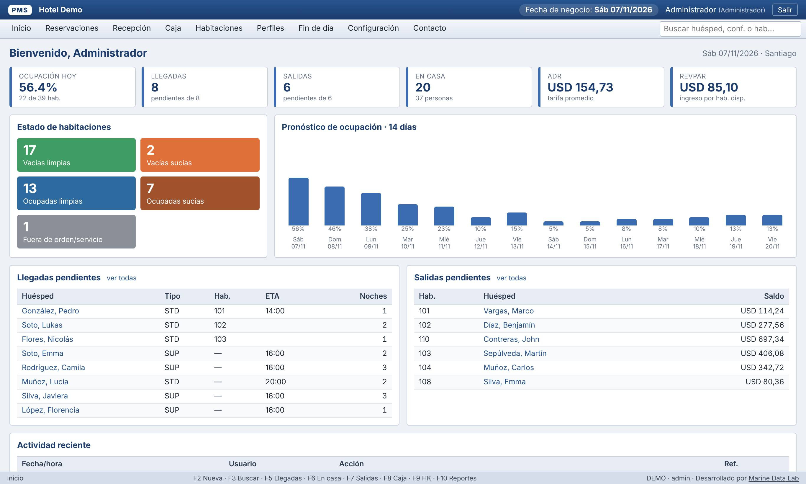

Es la primera pantalla después de iniciar sesión. Se vuelve a ella con **Inicio** en el menú.

- **Indicadores del día:** ocupación, llegadas pendientes, salidas pendientes, huéspedes en casa (con número de personas), ADR y RevPAR.
- **Estado de habitaciones:** cuántas hay vacías limpias, vacías sucias, ocupadas limpias, ocupadas sucias y fuera de orden o servicio. Haga clic en un recuadro para abrir el plano de habitaciones filtrado por ese estado (el de fuera de orden/servicio abre la lista de habitaciones bloqueadas).
- **Pronóstico de ocupación · 14 días:** una barra por día. Pase el ratón sobre una barra para ver el número de habitaciones. Las barras se pintan en naranja desde 60 % y en rojo desde 85 % de ocupación.
- **Llegadas pendientes** y **Salidas pendientes** (hasta 8 de cada una), con el enlace *ver todas*. Haga clic en un huésped para abrir su reserva o su folio.
- **Actividad reciente:** las últimas acciones registradas en la bitácora.

---

## 6. Reservaciones

### 6.1 Nueva reserva

**Menú:** Reservaciones → Nueva reserva · **Atajo:** `F2`

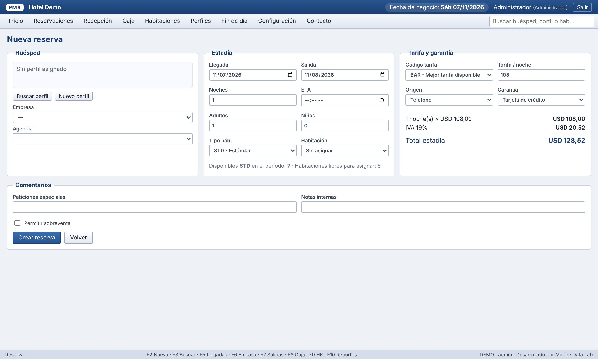

El formulario tiene cuatro bloques.

**Huésped**

1. Pulse **Buscar perfil** y escriba apellido, nombre, email o documento; luego pulse **Seleccionar** en el huésped correcto.
2. Si el huésped es nuevo, pulse **Nuevo perfil** y complete sus datos ([10.1](#101-perfiles-de-huéspedes)). Al guardar queda asignado a la reserva.
3. Opcionalmente elija la **Empresa** y/o la **Agencia**. Al elegir una empresa con tarifa negociada, el código de tarifa cambia automáticamente a esa tarifa. Si el perfil del huésped ya tiene empresa, se completa sola.

**Estadía**

- **Llegada** y **Salida**. También puede escribir el número de **Noches** y la salida se calcula sola.
- **ETA**: hora estimada de llegada.
- **Adultos** y **Niños**. La suma no puede superar la ocupación máxima del tipo de habitación más una persona.
- **Tipo hab.**: Estándar (STD), Superior (SUP), Junior Suite (JS) o Suite (STE).
- **Habitación**: puede dejarla *Sin asignar* o elegir una de las habitaciones libres para todo el período. La lista muestra el estado de limpieza de cada una.
- Debajo aparece cuántas habitaciones de ese tipo quedan disponibles en el período.

**Tarifa y garantía**

- **Código tarifa**: al cambiarlo (o al cambiar el tipo de habitación) se carga el precio de la tarifa.
- **Tarifa / noche**: puede modificarla manualmente.
- **Origen**: Teléfono, Email, Web, OTA, Walk-in, Agencia o Empresa.
- **Garantía**: Tarjeta de crédito, Depósito, Cuenta empresa o Sin garantía. Determina si se cobra el *no show* (ver [11.1](#111-auditoría-nocturna)).
- El recuadro de **totales** muestra noches × tarifa, el IVA y el **total de la estadía**.

**Comentarios**

- **Peticiones especiales**: lo que el huésped solicita (se muestra al hacer el check-in). Se precarga con las preferencias del perfil.
- **Notas internas**: sólo para el personal.
- **Permitir sobreventa**: márquelo sólo si quiere crear la reserva aunque no queden habitaciones de ese tipo.

Pulse **Crear reserva**. El sistema muestra el **número de confirmación** (por ejemplo, *Reserva creada · Confirmación 100185*) y abre la ficha de la reserva.

> **Atajos para crear reservas:** también puede empezar una reserva haciendo clic en una celda de la pantalla *Disponibilidad* (completa tipo y fecha), con doble clic en una celda vacía del *Rack* (completa habitación y fecha) o con **Nueva reserva** desde la ficha de un huésped (completa el perfil).

### 6.2 Ficha de una reserva existente

Se abre haciendo clic en un número de confirmación o en el nombre del huésped en cualquier listado. La franja superior muestra el estado, quién la creó y cuándo, las horas de check-in y check-out y, si corresponde, el número y motivo de cancelación.

Botones disponibles según el estado:

| Botón | Cuándo aparece | Qué hace |
|---|---|---|
| **Check-in** | Reserva *Reservada* con llegada hoy | Abre la ventana de check-in ([7.1](#71-llegadas-y-check-in)) |
| **Folio** | Huésped en casa, estadía cerrada o folio con movimientos | Abre la cuenta del huésped |
| **Confirmación** | Siempre | Imprime la carta de confirmación |
| **Cancelar** | Reserva *Reservada* | Pide el motivo y la cancela |
| **Reactivar** | Reserva *Cancelada* con llegada hoy o futura | La vuelve a *Reservada* |

**Modificar una reserva:** cambie los campos y pulse **Guardar cambios**. El sistema vuelve a comprobar disponibilidad.

**Extender o acortar una estadía en curso:** en una reserva *En casa* sólo se puede cambiar la fecha de **Salida** y los datos de tarifa o comentarios. La llegada, el tipo y la habitación quedan bloqueados; para cambiar de habitación use **Mover** ([7.2](#72-huéspedes-en-casa)).

**Cancelar:** pulse **Cancelar**, elija el motivo (Cambio de planes del huésped, Encontró otra opción, Error en reserva, Cancelación por la agencia u Otro) y confirme. Se genera un número de cancelación `CX` + número de confirmación y se libera la habitación asignada. Sólo se pueden cancelar reservas que aún no han llegado.

### 6.3 Buscar reservas

**Menú:** Reservaciones → Buscar reservas · **Atajo:** `F3`

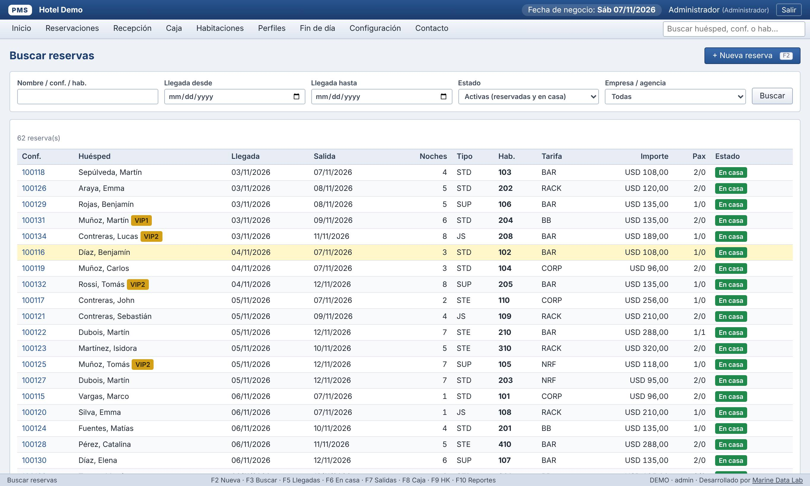

Filtros disponibles:

- **Nombre / conf. / hab.**: busca en nombre, apellido, número de confirmación, habitación y email.
- **Llegada desde / hasta**: rango de fechas de llegada.
- **Estado**: por defecto *Activas* (reservadas y en casa). También puede elegir un estado concreto o *Todas*.
- **Empresa / agencia**.

Pulse **Buscar**. Los resultados se ordenan por fecha de llegada; haga clic en la confirmación para abrir la reserva. La columna *Pax* muestra adultos/niños.

### 6.4 Disponibilidad

**Menú:** Reservaciones → Disponibilidad

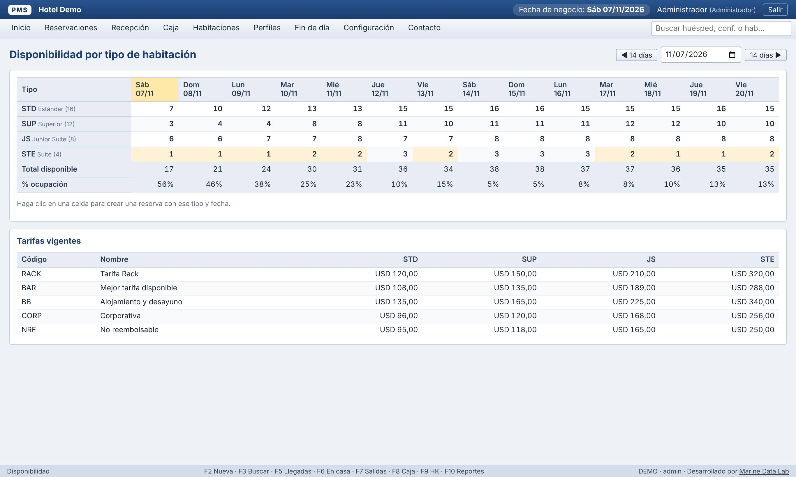

Muestra, para 14 días, cuántas habitaciones de cada tipo quedan libres, el total disponible y el % de ocupación por día.

- Las celdas sin disponibilidad se marcan en rojo y las que tienen 1 o 2 habitaciones libres, en amarillo.
- Navegue con **◀ 14 días** / **14 días ▶** o elija una fecha de inicio.
- **Haga clic en una celda** para crear una reserva con ese tipo de habitación y esa fecha de llegada (sólo fechas de hoy en adelante).
- Al pie se muestra la tabla de **tarifas vigentes** por tipo de habitación.

### 6.5 Rack de reservas (*tape chart*)

**Menú:** Reservaciones → Rack de reservas

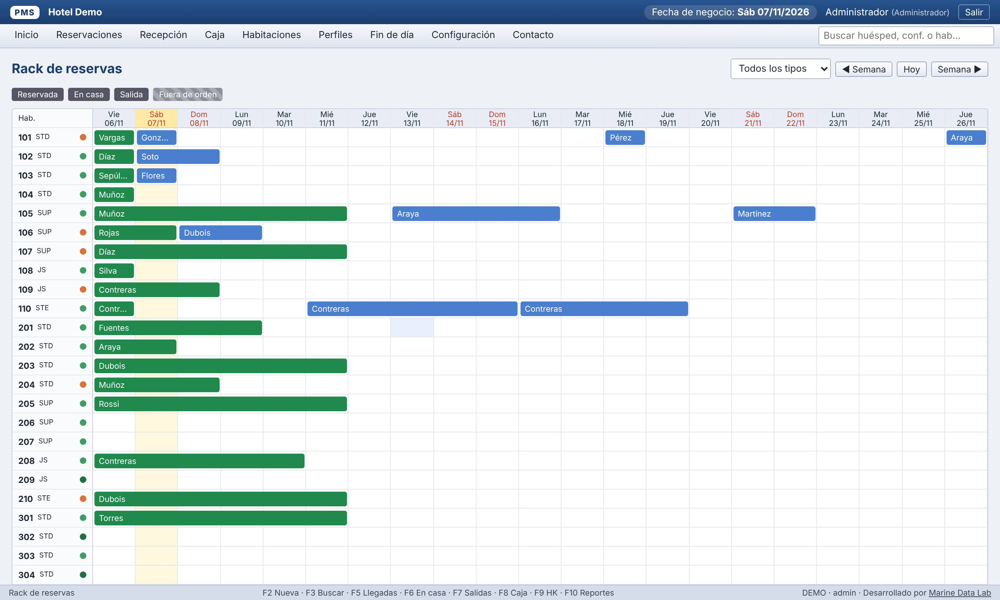

Es un calendario de 21 días con una fila por habitación. Cada reserva se dibuja como una barra con el apellido del huésped:

- Colores: **Reservada**, **En casa**, **Salida** y **OOO** (fuera de orden), según la leyenda.
- El punto de color junto al número de habitación indica su estado de limpieza.
- La columna de hoy está resaltada y los sábados y domingos aparecen en rojo.

Uso:

- Filtre por **tipo de habitación** y navegue con **◀ Semana**, **Hoy** y **Semana ▶**.
- Haga clic en una barra para abrir la reserva. Pase el ratón por encima para ver nombre, fechas y tarifa.
- **Doble clic en una celda vacía** (de hoy en adelante) para crear una reserva en esa habitación y fecha (sólo roles con permiso de reservas).
- Debajo se listan las **reservas sin habitación asignada** en el período, útiles para planificar la asignación.

---

## 7. Recepción

### 7.1 Llegadas y check-in

**Menú:** Recepción → Llegadas · **Atajo:** `F5`

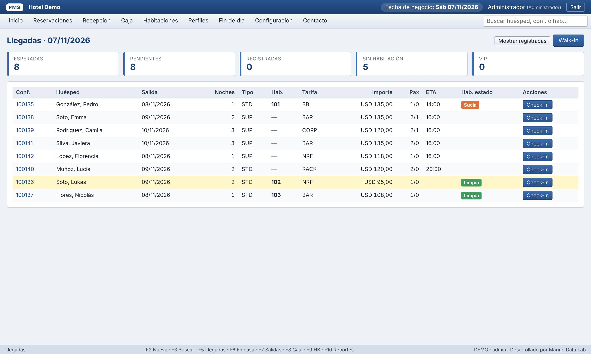

Lista las reservas que llegan en la fecha de negocio, ordenadas por hora estimada (ETA). Arriba se resumen las llegadas esperadas, pendientes, registradas, sin habitación y VIP. Use **Mostrar registradas** para ver también las que ya hicieron check-in (con el botón **Tarjeta** para reimprimir la tarjeta de registro).

**Para registrar una llegada:**

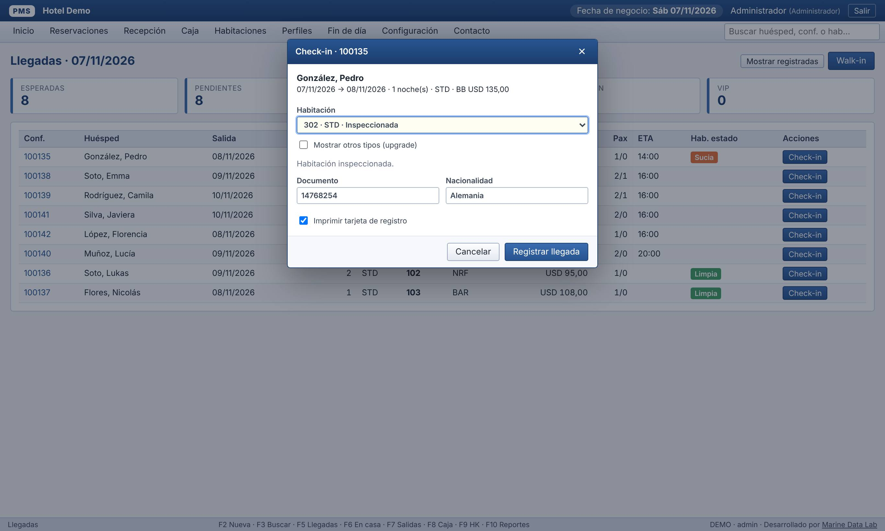

1. Pulse **Check-in** en la fila del huésped (o en la ficha de la reserva).
2. Revise los datos de la estadía y las peticiones especiales.
3. Elija la **Habitación**. Se ofrecen las habitaciones *vacías* y libres del tipo reservado; si la reserva ya tenía habitación asignada y está vacía, aparece seleccionada.
4. Para un **upgrade** o cambio de tipo, marque **Mostrar otros tipos (upgrade)**. El tipo de la reserva se actualizará al de la habitación elegida (la tarifa no cambia).
5. Lea el aviso bajo la habitación: si dice **"Atención: la habitación está SUCIA"**, elija otra o coordine con ama de llaves.
6. Verifique o complete **Documento** y **Nacionalidad**; se guardan en el perfil del huésped.
7. Deje marcada **Imprimir tarjeta de registro** si quiere imprimirla para la firma del huésped.
8. Pulse **Registrar llegada**.

La reserva pasa a *En casa* y la habitación a *Ocupada*.

> **¿La habitación asignada no aparece en la lista?** Probablemente sigue ocupada por un huésped que sale hoy. Haga primero el check-out de ese huésped o elija otra habitación.

### 7.2 Huéspedes en casa

**Menú:** Recepción → Huéspedes en casa · **Atajo:** `F6`

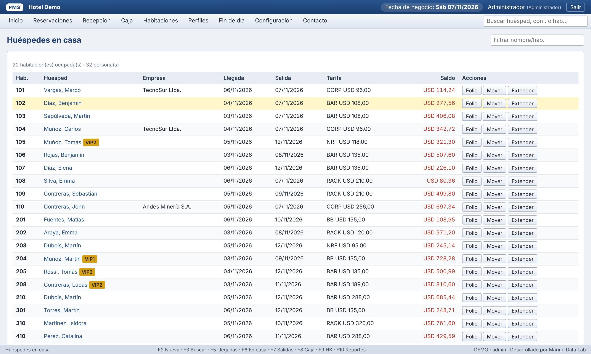

Lista de todas las habitaciones ocupadas, con empresa, fechas, tarifa y **saldo** (en rojo si es positivo). Filtre escribiendo un nombre o habitación y pulsando **Enter**.

Acciones por huésped:

- **Folio**: abre la cuenta ([8.2](#82-folio-del-huésped)).
- **Mover**: cambio de habitación. Elija una habitación vacía y libre hasta la fecha de salida, escriba el motivo (ruido, upgrade, mantenimiento…) y pulse **Mover**. La habitación anterior queda *Vacía* y *Sucia* y el tipo de la reserva pasa a ser el de la nueva habitación.
- **Extender**: abre la reserva para cambiar la fecha de salida ([6.2](#62-ficha-de-una-reserva-existente)).

### 7.3 Salidas y check-out

**Menú:** Recepción → Salidas · **Atajo:** `F7`

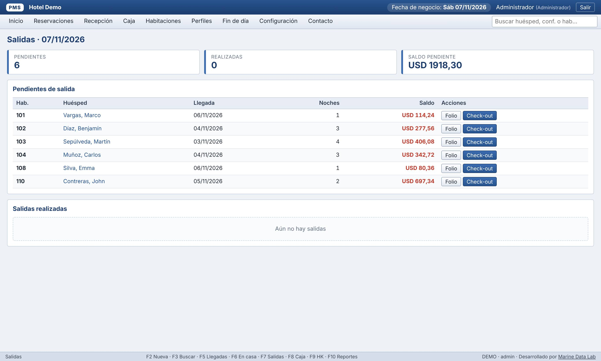

Muestra los huéspedes que deben salir hoy (o que debían salir antes y siguen en casa), el saldo de cada uno y el saldo total pendiente. Abajo aparecen las salidas ya realizadas con el estado de limpieza de la habitación.

**Para registrar una salida:**

1. Pulse **Folio** y revise los cargos con el huésped. Agregue los consumos de última hora si los hay.
2. Pulse **Check-out**.
   - Si el saldo **no es cero**, el sistema avisa *Saldo pendiente … Liquide el folio antes del check-out*, abre el folio y la ventana de **pago** con el importe pendiente ya completado.
   - Si el saldo es cero, pide confirmación.
3. Confirme con **Check-out**.

La reserva pasa a *Salida* y la habitación a *Vacía* y *Sucia*.

**Salida anticipada:** si el huésped se va antes de la fecha prevista, el sistema lo advierte y ajusta la fecha de salida a hoy (o a la noche siguiente a la llegada si llegó hoy).

### 7.4 Walk-in

**Menú:** Recepción → Walk-in (o botón **Walk-in** en Llegadas)

Un *walk-in* es un huésped que llega sin reserva. El formulario es el mismo de la nueva reserva ([6.1](#61-nueva-reserva)), con la llegada fijada en la fecha de negocio:

1. Busque o cree el perfil del huésped.
2. Indique la salida, el tipo de habitación y **asigne una habitación** (obligatorio).
3. Revise la tarifa y la garantía.
4. Pulse **Crear y registrar llegada**.

El sistema crea la reserva, hace el check-in y abre el folio para que pueda registrar el pago o depósito. Si no asignó habitación, la reserva se crea pero queda pendiente de check-in.

También puede iniciar un walk-in en una habitación concreta desde el **Plano de habitaciones** con el botón **Walk-in en esta hab.**

### 7.5 Plano de habitaciones

**Menú:** Recepción → Plano de habitaciones (o los recuadros de estado del Inicio)

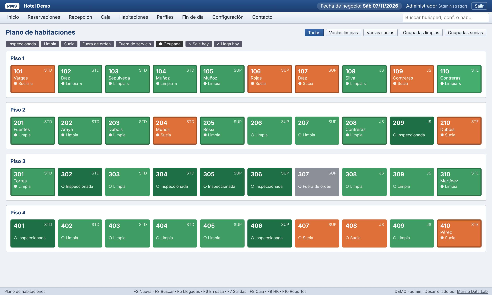

Muestra el hotel piso por piso. Cada casilla indica el número y tipo de habitación, el huésped (o `↗` y el apellido si llega hoy), si está ocupada (`●`) o vacía (`○`), su estado de limpieza y `↘` si el huésped sale hoy. El color de fondo corresponde al estado de limpieza.

- Use los botones **Todas**, **Vacías limpias**, **Vacías sucias**, **Ocupadas limpias** y **Ocupadas sucias** para resaltar sólo esas habitaciones.
- **Haga clic en una habitación** para ver su ficha: tipo y camas, estados, camarera asignada, bloqueo, huésped actual y próxima llegada. Desde ahí puede:
  - cambiar el estado de limpieza (roles con acceso a Ama de llaves),
  - abrir el **Folio** del huésped,
  - iniciar un **Walk-in en esta hab.** si está vacía y no está bloqueada.

---

## 8. Caja

### 8.1 Facturación / Folios

**Menú:** Caja → Facturación / Folios · **Atajo:** `F8`

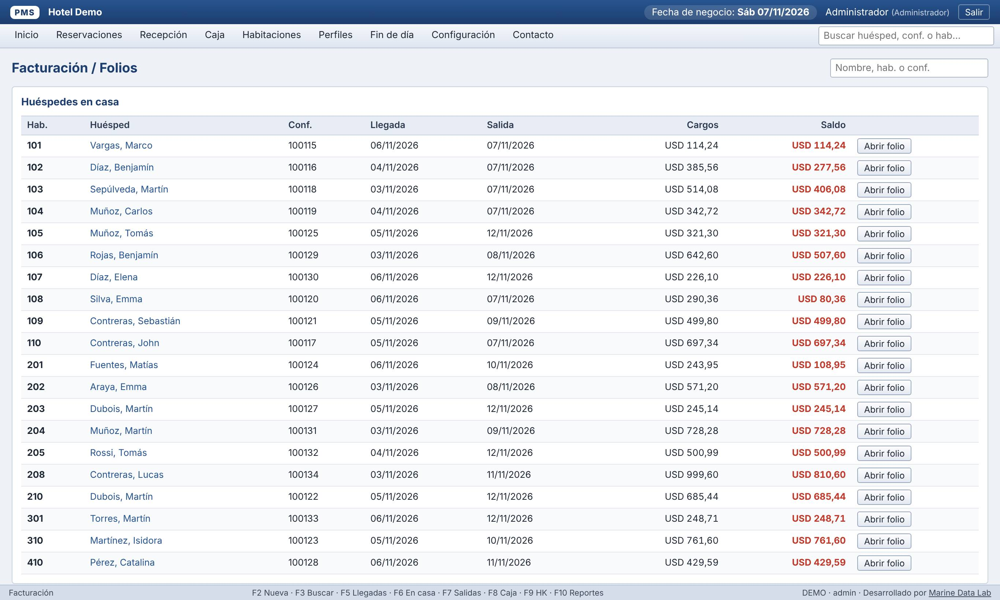

Muestra dos listas: los folios de **huéspedes en casa** y los **folios cerrados recientes** (últimas 25 salidas o no shows con movimientos), con el total de cargos y el saldo. Escriba nombre, habitación o confirmación y pulse **Enter** para filtrar. Pulse **Abrir folio** para entrar a la cuenta.

### 8.2 Folio del huésped

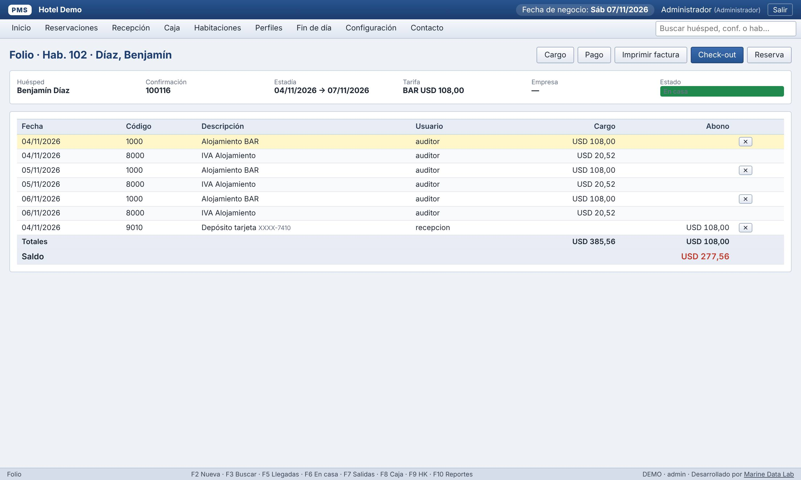

El encabezado resume huésped, confirmación, estadía, tarifa, empresa y estado. La tabla muestra cada movimiento con fecha, código, descripción, usuario, cargo o abono, y al pie los totales y el **saldo** (rojo si el huésped debe dinero, verde si está saldado).

El folio admite movimientos mientras el huésped está en casa, o si la estadía está cerrada (salida o no show) con saldo distinto de cero.

**Registrar un cargo**

1. Pulse **Cargo**.
2. Elija el **Código** (Restaurante, Bar, Room service, Desayuno, Minibar, Lavandería, Spa, Estacionamiento, Misceláneos, Alojamiento).
3. Escriba el **Monto** unitario y la **Cantidad**; el sistema multiplica ambos.
4. Opcionalmente agregue una **Descripción**.
5. Pulse **Registrar**.

Si el código es gravable, el sistema agrega automáticamente una línea de **IVA** con el porcentaje configurado. *Misceláneos* no lleva IVA.

**Registrar un pago**

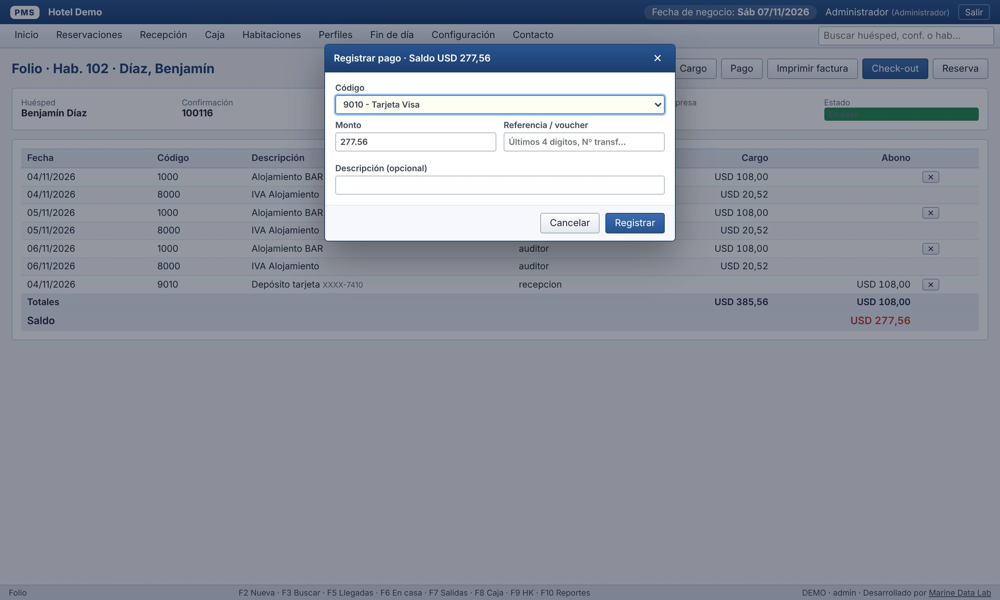

1. Pulse **Pago**. El monto viene completado con el saldo pendiente.
2. Elija la forma de pago: Efectivo, Tarjeta Visa, Mastercard, Amex, Transferencia o **Cuenta por cobrar (City Ledger)**.
3. Escriba una **Referencia** (últimos 4 dígitos de la tarjeta, número de transferencia…).
4. Pulse **Registrar**.

Puede registrar varios pagos parciales con distintas formas de pago. Para usar **City Ledger** la reserva debe tener una empresa o agencia asignada (ver [8.3](#83-cuentas-por-cobrar-city-ledger)).

**Corregir un movimiento**

Si un cargo o pago se registró por error:

1. Pulse **✕** en la fila del movimiento.
2. Escriba el **Motivo** (por ejemplo, *cargo duplicado*).
3. Pulse **Corregir**.

El sistema no borra el movimiento: lo tacha y agrega un movimiento inverso con la palabra *Corrección*. Si el cargo tenía IVA, también se corrige su impuesto. Las líneas de IVA no se corrigen por separado.

**Otros botones**

- **Imprimir factura**: imprime la factura con los datos del cliente (la empresa, si la reserva tiene una; si no, el huésped), los movimientos válidos (sin los corregidos), neto, IVA, total, pagado y saldo.
- **Check-out**: disponible si el huésped está en casa ([7.3](#73-salidas-y-check-out)).
- **Reserva**: vuelve a la ficha de la reserva.

### 8.3 Cuentas por cobrar (City Ledger)

**Menú:** Caja → Cuentas por cobrar

Cuando una empresa o agencia paga la estadía después (crédito), el saldo del folio se transfiere a su cuenta con la forma de pago **9050 – Cuenta por cobrar (City Ledger)**. Así el folio del huésped queda en cero y puede hacer check-out.

La pantalla muestra:

- **Saldos por cuenta**: total adeudado por cada empresa o agencia.
- **Detalle**: cada transferencia con fecha, cuenta, huésped, confirmación e importe.

> Para que una empresa pueda recibir crédito, márquela como *Habilitada para crédito (City Ledger)* en su ficha ([10.3](#103-empresas-y-agencias)).

---

## 9. Habitaciones

### 9.1 Ama de llaves

**Menú:** Habitaciones → Ama de llaves · **Atajo:** `F9`

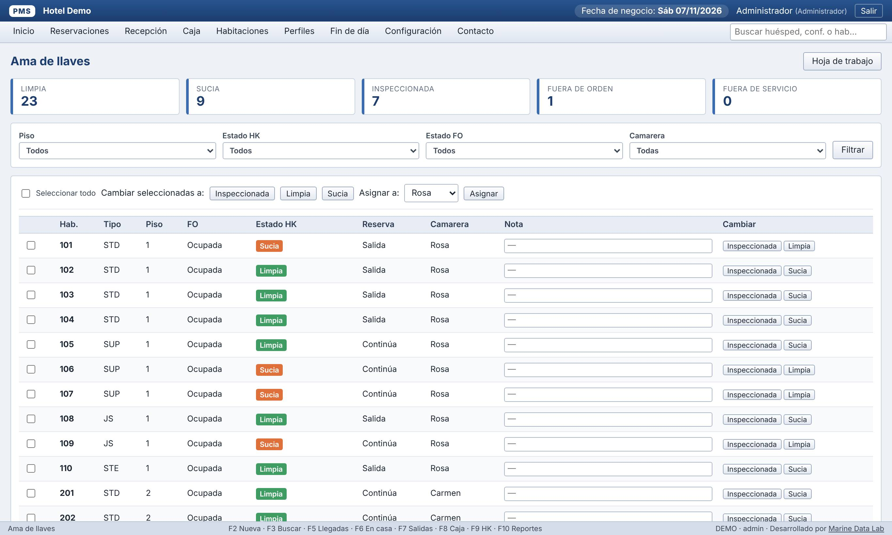

Arriba se cuenta cuántas habitaciones hay en cada estado. La tabla muestra, para cada habitación, tipo, piso, estado FO, estado HK, situación de la reserva y camarera asignada.

La columna **Reserva** indica:

| Valor | Significado |
|---|---|
| **Llegada** | Llega un huésped hoy: prioridad de limpieza |
| **Salida** | El huésped sale hoy |
| **Continúa** | El huésped sigue alojado |
| **Salió** | El huésped ya hizo check-out hoy |

**Filtrar:** elija piso, estado HK, estado FO o camarera y pulse **Filtrar**.

**Cambiar el estado de una habitación:** use los botones de la columna **Cambiar** (Inspeccionada, Limpia, Sucia). Para las habitaciones bloqueadas aparece **Gestionar**, que lleva a *Fuera de orden / servicio*.

**Cambios masivos:**

1. Marque las casillas de las habitaciones (o **Seleccionar todo**).
2. Pulse el nuevo estado en **Cambiar seleccionadas a:**. Las habitaciones bloqueadas se omiten.

**Asignar camareras:** seleccione las habitaciones, elija la camarera en **Asignar a:** y pulse **Asignar**.

**Notas:** escriba en la columna **Nota** (por ejemplo, *cambiar cortina*) y salga del campo; la nota se guarda sola.

**Hoja de trabajo:** el botón **Hoja de trabajo** imprime una lista por camarera con sus habitaciones, estados, situación de la reserva, notas y una casilla ☐ para marcar lo realizado.

### 9.2 Fuera de orden / servicio

**Menú:** Habitaciones → Fuera de orden / servicio

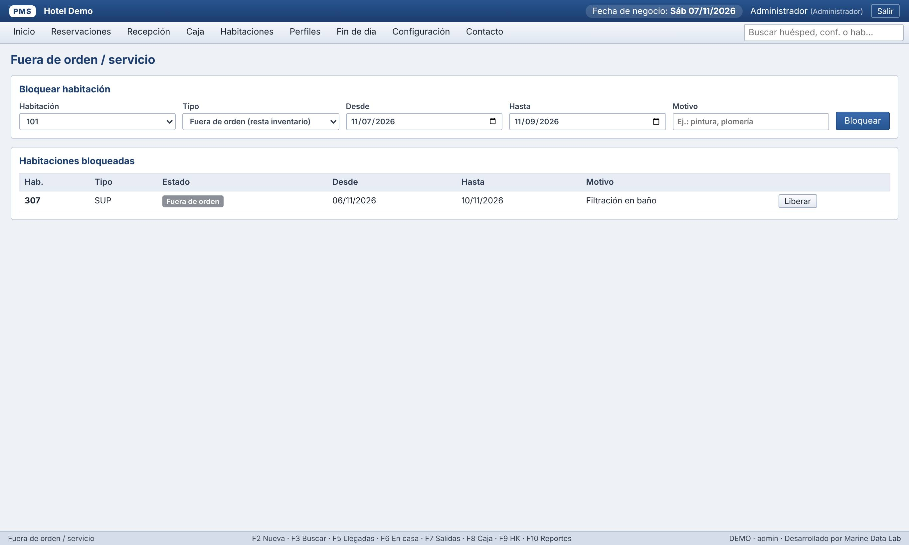

**Bloquear una habitación:**

1. Elija la **Habitación**.
2. Elija el **Tipo**:
   - **Fuera de orden (resta inventario)**: para reparaciones; la habitación no se puede vender en el rango de fechas y aparece como *OOO* en el rack.
   - **Fuera de servicio (no resta)**: bloqueo temporal menor; sigue contando en el inventario. Este bloqueo no usa las fechas y se mantiene hasta que se libere manualmente.
3. Indique **Desde**, **Hasta** (la habitación vuelve a estar disponible el día *Hasta*) y el **Motivo** (obligatorio).
4. Pulse **Bloquear**.

No se puede bloquear una habitación ocupada con fecha desde hoy. Si el bloqueo de *fuera de orden* empieza en el futuro, la habitación cambia de estado cuando la auditoría nocturna llega a esa fecha. Al terminar el período, la auditoría la libera automáticamente y la deja *Sucia*.

**Liberar:** pulse **Liberar** en la lista de habitaciones bloqueadas. La habitación queda *Sucia* para que se limpie antes de venderla.

---

## 10. Perfiles

### 10.1 Perfiles de huéspedes

**Menú:** Perfiles → Huéspedes

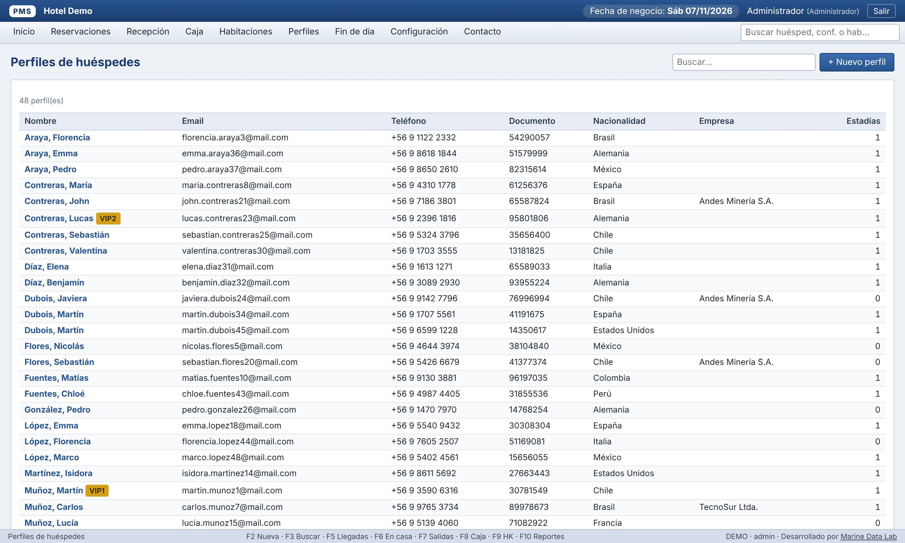

Lista de todos los huéspedes con email, teléfono, documento, nacionalidad, empresa y número de estadías. Escriba en **Buscar...** y pulse **Enter** para filtrar.

**Crear un perfil:** pulse **+ Nuevo perfil** y complete:

- **Apellidos** y **Nombre** (obligatorios).
- **VIP**: nivel VIP1, VIP2 o VIP3 (aparece como etiqueta en todos los listados).
- Email, teléfono, fecha de nacimiento.
- Tipo de documento (Pasaporte, DNI / Cédula, RUT, Licencia) y número.
- Nacionalidad, dirección, ciudad y empresa.
- **Preferencias** (piso alto, almohada extra…): se copian a las peticiones especiales de nuevas reservas.
- **Notas**.

No se pueden crear dos perfiles con el mismo email: el sistema avisa del perfil existente.

**Ficha del huésped:**

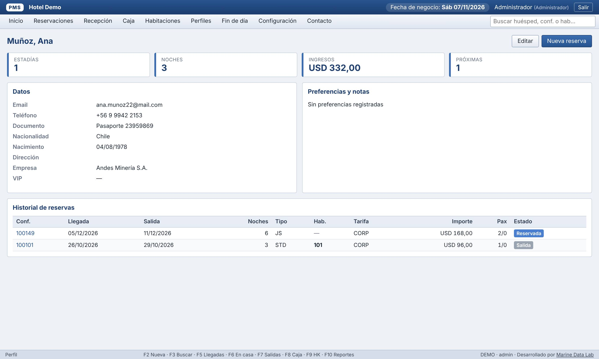

Haga clic en el nombre para abrir la ficha, con:

- Indicadores: **estadías** completadas, **noches**, **ingresos** generados (sin impuestos) y reservas **próximas**.
- Datos personales, preferencias y notas.
- **Historial de reservas** completo.
- Botones **Editar** y **Nueva reserva** (con el huésped ya asignado).

### 10.2 Huéspedes VIP

Los huéspedes con nivel VIP se identifican con una etiqueta en llegadas, en casa, búsquedas, check-in y folio. La pantalla de llegadas muestra cuántos VIP llegan hoy.

### 10.3 Empresas y agencias

**Menú:** Perfiles → Empresas y agencias

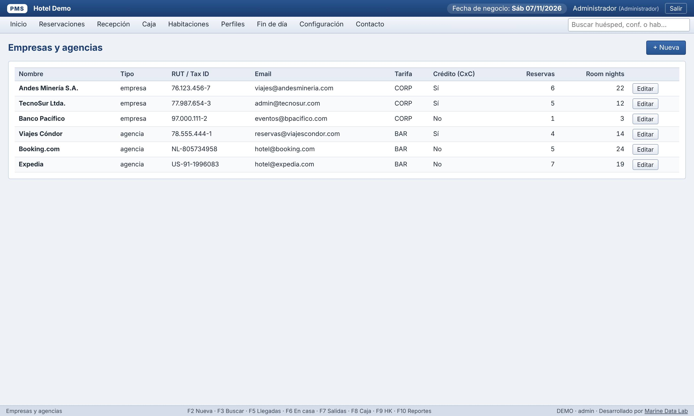

Lista de empresas y agencias con RUT o Tax ID, email, tarifa negociada, si tienen crédito, y su producción: número de **reservas** y **room nights** (noches vendidas, sin contar canceladas).

Pulse **+ Nueva** o **Editar** para gestionar:

- **Nombre** y **Tipo** (empresa o agencia).
- RUT / Tax ID, email y teléfono.
- **Tarifa negociada**: se aplica automáticamente al elegir esta empresa en una reserva.
- **Habilitada para crédito (City Ledger)**.

---

## 11. Fin de día

### 11.1 Auditoría nocturna

**Menú:** Fin de día → Auditoría nocturna · **Roles:** Administrador y Auditor

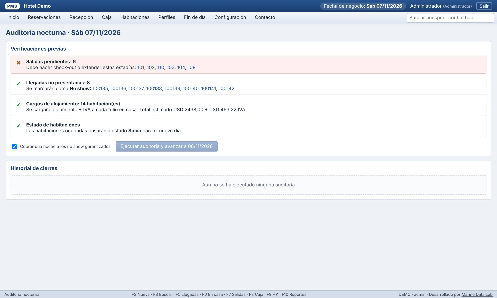

La auditoría nocturna **cierra la fecha de negocio** y la avanza al día siguiente. Se ejecuta una vez al día, normalmente de madrugada, cuando terminó la actividad de recepción.

La pantalla muestra las **verificaciones previas**:

| Verificación | Qué revisa | ¿Bloquea el cierre? |
|---|---|---|
| **Salidas pendientes** | Huéspedes en casa cuya salida es hoy o anterior | **Sí.** Debe hacer su check-out o extender la estadía. Los enlaces llevan a sus folios |
| **Llegadas no presentadas** | Reservas de hoy sin check-in | No. Se marcarán como **No show** |
| **Cargos de alojamiento** | Huéspedes que continúan | No. Muestra el total que se cargará más IVA |
| **Estado de habitaciones** | — | No. Informa que las ocupadas pasarán a *Sucia* |

**Para cerrar el día:**

1. Resuelva las salidas pendientes hasta que la primera verificación quede en verde (✔).
2. Decida si deja marcada **Cobrar una noche a los no show garantizados**. Se cobra una noche (código *No show*, más IVA) sólo a las reservas con garantía *Tarjeta de crédito*, *Depósito* o *Cuenta empresa*.
3. Pulse **Ejecutar auditoría y avanzar a …** y confirme con **Cerrar día**.

El sistema:

1. Marca como **No show** las llegadas no presentadas y les quita la habitación asignada.
2. Carga una noche de **alojamiento + IVA** al folio de cada huésped en casa.
3. Pasa a **Sucia** todas las habitaciones ocupadas.
4. Guarda las estadísticas del día (ocupación, ingreso por habitaciones, IVA, ADR, RevPAR, no shows).
5. **Avanza la fecha de negocio** un día.
6. Actualiza los bloqueos de habitaciones según la nueva fecha.

Al terminar aparece un resumen. El **Historial de cierres** de la misma pantalla muestra todos los cierres anteriores con quién y cuándo los ejecutó.

> ⚠️ **El cierre del día no se puede deshacer.** Antes de ejecutarlo, verifique que se registraron todas las llegadas y salidas. Si trabaja con datos reales, exporte un respaldo JSON antes ([12.1](#121-datos-del-hotel)).

### 11.2 Reportes

**Menú:** Fin de día → Reportes · **Atajo:** `F10`

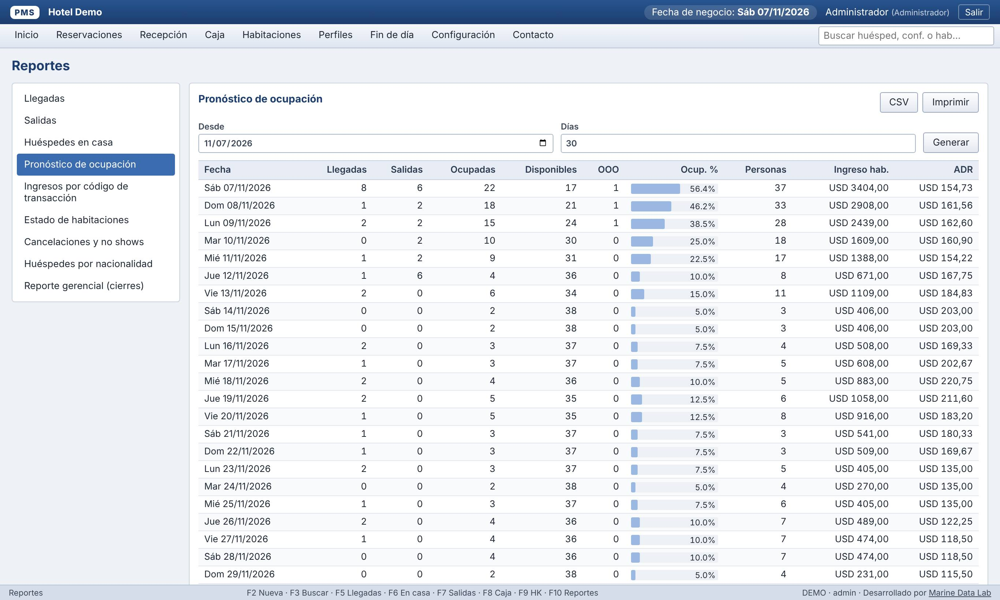

Elija un reporte en la lista de la izquierda, ajuste los parámetros (si los tiene) y pulse **Generar**.

| Reporte | Parámetros | Contenido |
|---|---|---|
| **Llegadas** | Fecha | Reservas con llegada en esa fecha (excepto canceladas) |
| **Salidas** | Fecha | Estadías con salida en esa fecha, con saldo |
| **Huéspedes en casa** | — | Todos los huéspedes alojados, por habitación, con saldo |
| **Pronóstico de ocupación** | Desde, Días (1–90) | Por día: llegadas, salidas, ocupadas, disponibles, fuera de orden, % ocupación, personas, ingreso y ADR, con totales |
| **Ingresos por código de transacción** | Desde, Hasta | Suma por código; totales de cargos netos, impuestos y pagos. Por defecto, los últimos 30 días |
| **Estado de habitaciones** | — | Estado FO y HK, camarera y notas de cada habitación |
| **Cancelaciones y no shows** | — | Reservas canceladas o no presentadas, con motivo |
| **Huéspedes por nacionalidad** | — | Estadías y noches por país, con gráfico de barras |
| **Reporte gerencial (cierres)** | — | Indicadores de cada auditoría ejecutada |

Cada reporte se puede:

- **Imprimir** (o guardar como PDF).
- Exportar a **CSV** para abrirlo en Excel o Google Sheets. El archivo se llama `<reporte>_<fecha>.csv`.

---

## 12. Configuración

### 12.1 Datos del hotel

**Menú:** Configuración → Datos del hotel · **Rol:** Administrador

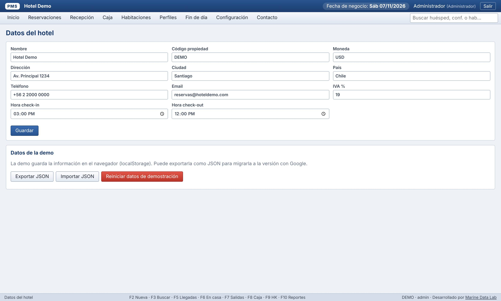

**Datos generales:** nombre, código de propiedad (hasta 6 caracteres), moneda (por ejemplo USD, CLP, EUR), dirección, ciudad, país, teléfono, email, **IVA %** y horas de **check-in** y **check-out**. Pulse **Guardar**.

- El nombre y los datos de contacto aparecen en las confirmaciones, tarjetas de registro y facturas.
- Un cambio de IVA afecta sólo a los cargos que se registren desde ese momento.
- La moneda es sólo una etiqueta: no convierte importes.

**Datos de la demo:**

- **Exportar JSON**: descarga un archivo `pms_<fecha>.json` con toda la información (respaldo o migración).
- **Importar JSON**: carga un archivo exportado antes y **reemplaza todos los datos actuales**.
- **Reiniciar datos de demostración**: borra todos los cambios y genera de nuevo los datos de ejemplo, con la fecha de hoy. Pide confirmación.

> Recomendación: exporte un JSON al final de cada jornada de prueba si quiere conservar el trabajo, ya que los datos viven sólo en ese navegador.

### 12.2 Tipos de habitación y tarifas

**Menú:** Configuración → Tipos de habitación y tarifas · **Roles:** Administrador y Reservas

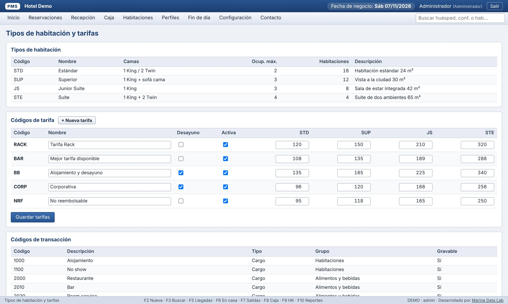

- **Tipos de habitación** (consulta): código, nombre, camas, ocupación máxima, número de habitaciones y descripción.
- **Códigos de tarifa** (editable): nombre, si incluye **desayuno**, si está **activa** y el precio por noche para cada tipo de habitación. Pulse **Guardar tarifas**. Las tarifas inactivas dejan de ofrecerse en nuevas reservas; las reservas existentes las conservan.
- **+ Nueva tarifa**: indique código, nombre, la tarifa **base** y un **ajuste %** (por ejemplo −10 para un 10 % de descuento). Los precios se calculan a partir de la tarifa base y luego se pueden ajustar en la tabla.
- **Códigos de transacción** (consulta): código, descripción, tipo (cargo, pago, impuesto), grupo y si es gravable.

Los cambios de precio afectan a las reservas nuevas; las existentes mantienen la tarifa con la que se crearon.

### 12.3 Usuarios y roles

**Menú:** Configuración → Usuarios y roles · **Rol:** Administrador

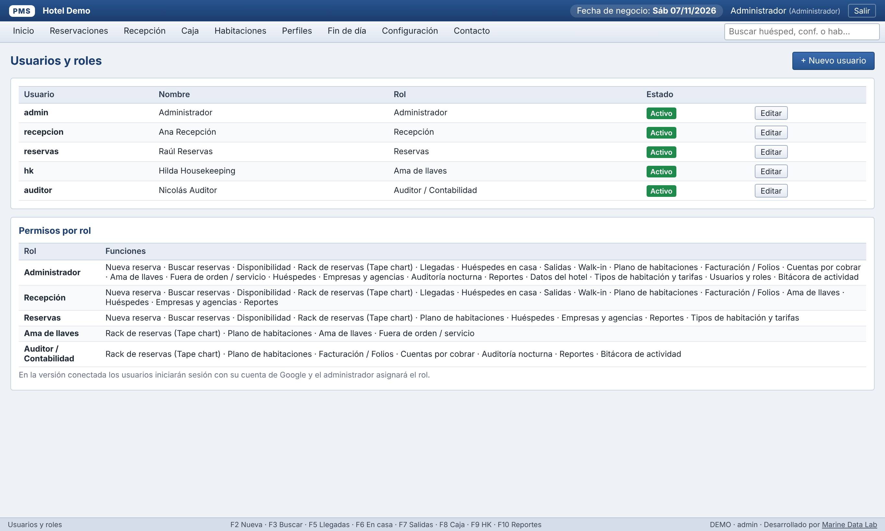

- **+ Nuevo usuario**: usuario (no se puede cambiar después), nombre, rol, contraseña y estado activo.
- **Editar**: cambia nombre, rol, estado o contraseña. Deje la contraseña en blanco para mantener la actual.
- Para quitar el acceso a una persona, desmarque **Activo**: el usuario deja de poder iniciar sesión y desaparece de la pantalla de inicio, pero su historial se conserva.
- Por seguridad, un administrador no puede desactivarse ni quitarse el rol de administrador a sí mismo.
- La tabla **Permisos por rol** resume qué funciones tiene cada rol.

### 12.4 Bitácora de actividad

**Menú:** Configuración → Bitácora de actividad · **Roles:** Administrador y Auditor

Registro de todas las acciones: inicios y cierres de sesión, reservas creadas, modificadas, canceladas y reactivadas, check-in y check-out, cambios de habitación, cargos y correcciones, cambios de estado de habitaciones, bloqueos, perfiles, tarifas, usuarios, configuración y cierres de auditoría. Cada línea indica fecha y hora, usuario, acción y referencia (normalmente el número de confirmación).

Escriba en **Filtrar...** (usuario, acción o referencia) y pulse **Enter**. Se conservan las últimas 500 acciones.

---

## 13. Contacto

**Menú:** Contacto (siempre visible) · también desde el enlace *¿Quieres este sistema? Contáctanos* de la pantalla de inicio de sesión.

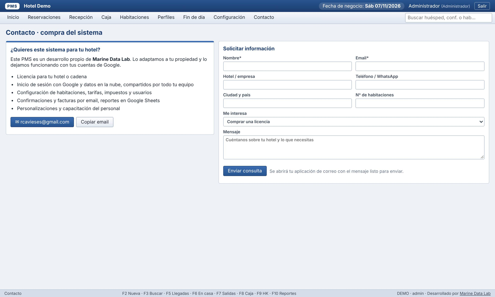

Información para adquirir una licencia del sistema, agendar una demostración o pedir personalizaciones a **Marine Data Lab**:

- Botón con el email de contacto y **Copiar email**.
- Formulario **Solicitar información** (nombre, email, hotel, teléfono, ciudad, número de habitaciones, interés y mensaje). Al pulsar **Enviar consulta** se abre su programa de correo con el mensaje ya redactado; sólo tiene que enviarlo.

---

## 14. Flujos de trabajo paso a paso

### 14.1 Un día típico en el hotel

| Momento | Quién | Qué hace | Dónde |
|---|---|---|---|
| Inicio del turno | Recepción | Revisa llegadas, salidas y ocupación del día | Inicio |
| Mañana | Ama de llaves | Imprime la hoja de trabajo y asigna camareras | Ama de llaves |
| Mañana | Recepción | Registra consumos y hace los check-out | Salidas, Folio |
| Durante el día | Ama de llaves | Marca habitaciones limpias / inspeccionadas | Ama de llaves, Plano |
| Durante el día | Reservas | Crea y modifica reservas, revisa disponibilidad | Reservaciones |
| Tarde | Recepción | Hace los check-in y los walk-ins | Llegadas, Walk-in |
| Noche | Recepción | Revisa saldos de huéspedes en casa | En casa, Caja |
| Madrugada | Auditor | Resuelve pendientes y cierra el día | Auditoría nocturna |
| Madrugada | Auditor | Imprime o exporta los reportes del día | Reportes |

### 14.2 Reserva telefónica

1. `F2` (Nueva reserva).
2. **Buscar perfil** por apellido o email. Si no existe, **Nuevo perfil**.
3. Fechas de llegada y salida (o número de noches), adultos y niños.
4. Tipo de habitación; revise la disponibilidad que muestra el formulario.
5. Código de tarifa (o elija la empresa para aplicar su tarifa negociada).
6. Garantía y peticiones especiales.
7. **Crear reserva** e informe al huésped el número de confirmación.
8. **Confirmación** para imprimirla o guardarla en PDF y enviarla.

### 14.3 Llegada de un huésped con reserva

1. `F5` (Llegadas) → **Check-in** en su fila.
2. Elija la habitación (evite las sucias) o marque *upgrade* si corresponde.
3. Verifique documento y nacionalidad.
4. **Registrar llegada**; haga firmar la tarjeta de registro impresa.
5. Si se pide un depósito: **Folio → Pago**.

### 14.4 Salida de un huésped

1. `F7` (Salidas) → **Folio**.
2. Agregue los consumos pendientes con **Cargo** (por ejemplo, minibar).
3. **Pago** por el saldo total con la forma de pago que use el huésped (o varias).
4. **Imprimir factura**.
5. **Check-out**.

### 14.5 Estadía pagada por una empresa (crédito)

1. En la reserva, elija la **Empresa** (habilitada para crédito).
2. Al salir, registre los pagos personales del huésped (por ejemplo, el minibar) con su tarjeta.
3. Registre el resto con **Pago → 9050 Cuenta por cobrar (City Ledger)**.
4. **Check-out**. La deuda aparece en **Caja → Cuentas por cobrar**.

### 14.6 Corregir un cargo mal registrado

1. Abra el folio.
2. Pulse **✕** en la fila del cargo erróneo, escriba el motivo y pulse **Corregir**.
3. Registre el cargo correcto con **Cargo**.

### 14.7 Cambio de habitación por un reclamo

1. `F6` (Huéspedes en casa) → **Mover**.
2. Elija una habitación vacía y limpia, escriba el motivo y pulse **Mover**.
3. Ama de llaves verá la habitación anterior como *Sucia*.

### 14.8 Extender una estadía

1. `F6` → **Extender** (o abra la reserva).
2. Cambie la fecha de **Salida** y pulse **Guardar cambios**. Si no hay disponibilidad en la habitación, el sistema lo avisa.

### 14.9 Cierre del día

1. `F7` y procese todas las salidas pendientes (o extiéndalas).
2. `F5` y confirme que las llegadas pendientes de verdad no vendrán.
3. **Fin de día → Auditoría nocturna**, verifique que todo esté en verde, decida el cargo de no show y **Ejecutar auditoría**.
4. **Reportes**: imprima o exporte *Reporte gerencial*, *Ingresos por código* y *Pronóstico de ocupación*.

---

## 15. Guía rápida por rol

### Recepción (`recepcion`)

- Empiece el turno en **Inicio**: llegadas, salidas y habitaciones sucias.
- Use los atajos `F5` llegadas, `F6` en casa, `F7` salidas y `F8` caja.
- Antes de cada check-in, compruebe que la habitación no esté *Sucia*.
- Nunca haga check-out sin revisar el folio con el huésped.
- Puede crear reservas y walk-ins, cambiar el estado de limpieza de habitaciones y consultar reportes.

### Reservas (`reservas`)

- Trabaje con **Nueva reserva** (`F2`), **Buscar** (`F3`), **Disponibilidad** y el **Rack**.
- Mantenga los perfiles de huéspedes y empresas al día y evite perfiles duplicados (busque antes de crear).
- Puede modificar tarifas en **Configuración → Tipos de habitación y tarifas**.
- Use *Permitir sobreventa* sólo con autorización.

### Ama de llaves (`hk`)

- Pantalla principal: **Ama de llaves** (`F9`).
- Al empezar: asigne camareras e imprima la **Hoja de trabajo**.
- Priorice las habitaciones con **Llegada** y las que tienen **Salió**.
- Marque *Limpia* al terminar y *Inspeccionada* tras la revisión.
- Use **Fuera de orden / servicio** para reparaciones y libere la habitación al terminar.
- El **Plano de habitaciones** y el **Rack** le dan una vista general.

### Auditor / Contabilidad (`auditor`)

- Ejecute la **Auditoría nocturna** una vez al día.
- Revise folios con saldo en **Caja** y la deuda de empresas en **Cuentas por cobrar**.
- Exporte los **Reportes** a CSV para contabilidad.
- Revise la **Bitácora** ante cualquier diferencia o corrección.

### Administrador (`admin`)

- Tiene acceso a todo.
- Configure los datos del hotel, el IVA y las tarifas antes de empezar a operar.
- Cree un usuario por persona; desactive a quienes dejen de trabajar en el hotel.
- Exporte respaldos JSON periódicamente.

---

## 16. Mensajes del sistema y solución de problemas

| Mensaje | Causa | Qué hacer |
|---|---|---|
| *Usuario o contraseña incorrectos* | Datos mal escritos o usuario inactivo | Revise mayúsculas y minúsculas; pida al administrador que active el usuario |
| *Acceso restringido* / *Sin permiso para esta función* | Su rol no incluye esa función | Pida a un usuario con el rol adecuado o al administrador |
| *Asigne un perfil de huésped* | La reserva no tiene huésped | Use **Buscar perfil** o **Nuevo perfil** |
| *La salida debe ser posterior a la llegada* | Fechas invertidas o iguales | Corrija las fechas; la estadía mínima es una noche |
| *La llegada no puede ser anterior a la fecha de negocio* | Fecha de llegada pasada | Use la fecha de negocio o una posterior |
| *La habitación … no está disponible en esas fechas* | Otra reserva o bloqueo se cruza con esas fechas | Elija otra habitación o déjela *Sin asignar* |
| *No hay disponibilidad para ese tipo de habitación…* | No quedan habitaciones de ese tipo | Cambie tipo o fechas, o marque *Permitir sobreventa* si está autorizado |
| *La ocupación excede la capacidad del tipo de habitación* | Demasiadas personas para el tipo | Elija un tipo de habitación más grande |
| *Sólo se puede registrar la llegada en la fecha de llegada* | Check-in antes o después de la fecha reservada | Modifique la fecha de llegada de la reserva |
| *No hay habitaciones vacías disponibles de este tipo* | Todas ocupadas o asignadas | Marque *Mostrar otros tipos (upgrade)* o haga primero los check-out pendientes |
| *Asigne una habitación para el walk-in* | Walk-in sin habitación | Elija una habitación en la reserva y haga el check-in |
| *Saldo pendiente … Liquide el folio antes del check-out* | El folio no está en cero | Registre el pago o transfiera a City Ledger |
| *City Ledger requiere empresa o agencia en la reserva* | Pago 9050 sin empresa ni agencia | Asigne la empresa en la reserva o use otra forma de pago |
| *Hay salidas pendientes…* | Auditoría con huéspedes que debían salir | Haga su check-out o extienda la estadía |
| *No se puede bloquear una habitación ocupada* / *La habitación está ocupada* | Bloqueo de una habitación con huésped | Mueva al huésped o programe el bloqueo para después de su salida |
| *Sólo se pueden cancelar reservas pendientes de llegada* | La reserva ya está en casa o cerrada | No se puede cancelar; si el huésped ya llegó, gestione su salida |
| *No se puede reactivar una reserva con llegada pasada* | La fecha de llegada ya pasó | Cree una reserva nueva |
| *Ya existe un perfil con ese email* | Perfil duplicado | Use el perfil existente |
| *Archivo inválido* (importar) | El JSON no es una exportación del sistema | Use un archivo generado con *Exportar JSON* |

**Otros problemas**

- **Los datos desaparecieron.** Se borraron los datos de navegación, se usó otro navegador o una ventana privada. Importe el último JSON exportado.
- **Otro usuario no ve mis cambios.** En la demo cada navegador tiene sus propios datos; no se comparten entre computadores. La versión conectada a Google resolverá esto.
- **Las fechas están desfasadas respecto al calendario real.** La fecha de negocio sólo avanza con la auditoría nocturna. Ejecútela o use *Reiniciar datos de demostración*.
- **La impresión sale con el menú o los botones.** Use los botones de impresión del sistema, no `Ctrl+P` sobre la pantalla.
- **Las teclas F no funcionan.** Cierre la ventana emergente abierta (`Esc`) o use `Fn` + F en su portátil.

---

## 17. Preguntas frecuentes

**¿Puedo usar el sistema sin conexión a internet?**
Una vez cargada la página, todo funciona en el navegador. Para abrirla por primera vez necesita acceso al sitio o al servidor local.

**¿Cómo cambio la moneda o el porcentaje de IVA?**
En **Configuración → Datos del hotel**. El IVA nuevo se aplica a los cargos registrados desde ese momento.

**¿Puedo borrar una reserva?**
No. Las reservas se **cancelan** (quedan en el historial con su motivo). Las que no llegan se marcan como *No show* en la auditoría.

**¿Puedo borrar un cargo?**
No. Se **corrige** con un movimiento inverso que deja constancia del motivo y del usuario.

**¿Qué diferencia hay entre "Limpia" e "Inspeccionada"?**
*Limpia* la marca la camarera al terminar; *Inspeccionada* la marca la supervisora después de revisar. Ambas permiten vender la habitación.

**¿Qué diferencia hay entre "Fuera de orden" y "Fuera de servicio"?**
*Fuera de orden* resta la habitación del inventario durante un período (no se puede vender). *Fuera de servicio* es un bloqueo menor que no la resta del inventario.

**¿Qué pasa si no ejecuto la auditoría?**
La fecha de negocio no avanza: no se cargan las noches de alojamiento, las llegadas no presentadas no pasan a *No show* y no se generan las estadísticas del día.

**¿Cómo reinicio la demo?**
**Configuración → Datos del hotel → Reiniciar datos de demostración** (rol Administrador).

**¿Cómo traslado los datos a otro computador?**
Exporte el JSON en el primero e impórtelo en el segundo desde la misma pantalla.

**¿Cómo consigo el sistema para mi hotel?**
Desde la pestaña **Contacto** o escribiendo a Marine Data Lab ([13](#13-contacto)).

---

## 18. Glosario

| Término | Definición |
|---|---|
| **ADR** | *Average Daily Rate*: tarifa promedio por habitación ocupada |
| **Auditoría nocturna** | Proceso de cierre diario que carga el alojamiento y avanza la fecha de negocio |
| **BAR** | *Best Available Rate*: mejor tarifa disponible |
| **City Ledger** | Cuentas por cobrar a empresas o agencias |
| **Check-in / Check-out** | Registro de llegada / salida del huésped |
| **Confirmación** | Número único que identifica una reserva |
| **ETA** | *Estimated Time of Arrival*: hora estimada de llegada |
| **FO** | *Front Office*: estado de recepción de la habitación (vacía u ocupada) |
| **Fecha de negocio** | Día hotelero en curso; avanza con la auditoría |
| **Folio** | Cuenta del huésped con cargos y pagos |
| **HK** | *Housekeeping*: ama de llaves; estado de limpieza de la habitación |
| **No show** | Huésped con reserva que no se presentó |
| **NRF** | Tarifa no reembolsable |
| **OOO** | *Out of Order*: fuera de orden |
| **OOS** | *Out of Service*: fuera de servicio |
| **OTA** | *Online Travel Agency*: agencia de viajes en línea (Booking.com, Expedia…) |
| **Pax** | Número de personas (adultos/niños) |
| **Rack** | Calendario gráfico de ocupación por habitación (*tape chart*) |
| **RevPAR** | *Revenue per Available Room*: ingreso por habitación disponible |
| **Room nights** | Noches de habitación vendidas |
| **Sobreventa** | Vender más habitaciones de las disponibles |
| **Upgrade** | Asignar una habitación de categoría superior |
| **VIP** | Huésped importante (niveles VIP1 a VIP3) |
| **Walk-in** | Huésped que llega sin reserva |

---

## 19. Anexo: datos de demostración

Al abrir la demo por primera vez (o al reiniciarla) se genera un hotel ficticio con datos relativos a la fecha del día:

**Hotel:** *Hotel Demo* (código DEMO), Santiago, Chile · moneda USD · IVA 19 % · check-in 15:00 · check-out 12:00.

**Habitaciones:** 40, en 4 pisos de 10 habitaciones. En cada piso:

| Habitaciones | Tipo | Ocupación máx. | Camas |
|---|---|---|---|
| x01–x04 | STD Estándar (24 m²) | 2 | 1 King / 2 Twin |
| x05–x07 | SUP Superior (30 m²) | 3 | 1 King + sofá cama |
| x08–x09 | JS Junior Suite (42 m²) | 3 | 1 King |
| x10 | STE Suite (65 m²) | 4 | 1 King + 2 Twin |

Camareras: Rosa (piso 1), Carmen (piso 2), Luis (piso 3) y Patricia (piso 4). La habitación 307 suele estar fuera de orden por una filtración en el baño.

**Tarifas (precio por noche):**

| Código | Nombre | STD | SUP | JS | STE |
|---|---|--:|--:|--:|--:|
| RACK | Tarifa Rack | 120 | 150 | 210 | 320 |
| BAR | Mejor tarifa disponible | 108 | 135 | 189 | 288 |
| BB | Alojamiento y desayuno | 135 | 165 | 225 | 340 |
| CORP | Corporativa | 96 | 120 | 168 | 256 |
| NRF | No reembolsable | 95 | 118 | 165 | 250 |

**Códigos de transacción:**

| Código | Descripción | Tipo | IVA |
|---|---|---|---|
| 1000 | Alojamiento | Cargo | Sí |
| 1100 | No show | Cargo | Sí |
| 2000 / 2010 / 2020 / 2030 | Restaurante / Bar / Room service / Desayuno | Cargo | Sí |
| 3000 / 4000 / 5000 / 6000 | Minibar / Lavandería / Spa / Estacionamiento | Cargo | Sí |
| 7000 | Misceláneos | Cargo | No |
| 8000 | Impuesto (IVA) | Impuesto | — |
| 9000 | Efectivo | Pago | — |
| 9010 / 9020 / 9030 | Tarjeta Visa / Mastercard / Amex | Pago | — |
| 9040 | Transferencia | Pago | — |
| 9050 | Cuenta por cobrar (City Ledger) | Pago | — |

**Empresas y agencias:** Andes Minería S.A., TecnoSur Ltda. y Banco Pacífico (empresas, tarifa CORP); Viajes Cóndor, Booking.com y Expedia (agencias, tarifa BAR).

**Reservas:** unos 48 perfiles de huéspedes, estadías ya cerradas, unos 20 huéspedes en casa (6 salen hoy), 8 llegadas para hoy, reservas futuras para las próximas 4 semanas y una reserva cancelada.

---

*Sistema desarrollado por **Marine Data Lab**. Para licencias, demostraciones o personalizaciones, escriba a [rcavieses@gmail.com](mailto:rcavieses@gmail.com) o use la pestaña **Contacto** de la aplicación.*
